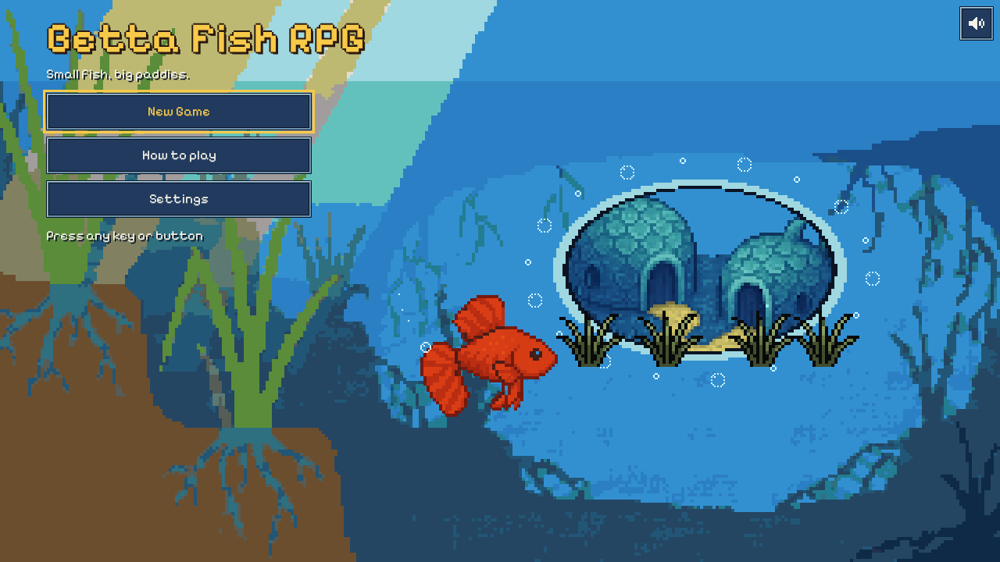

# Betta Fish RPG

*Small fish, big paddies. Find the missing fish, with your fins or your friendship.*

You're a young betta from Paddy Village, and fish keep vanishing from the outer paddies.
Swim the sunlit rice-paddy terraces, battle or befriend the fish in your way, gear up from
helmet to full metal, follow a trail of strange scales up to the city on the next terrace and
down into the dark Murk, where something very old and very lonely is waiting.

Play it in your browser: serve the `game/` folder with any static web server (for example
`python3 -m http.server --directory game`) and open it. No install, works on desktop and on
phones held sideways, with keyboard, mouse, touch or a controller.

## How to play

- **Swim:** arrow keys or WASD; on a phone, drag on the left side of the screen; on a
  controller, the left stick or d-pad.
- **Talk, pick up, confirm:** Space, E or Enter (✕ / A on a controller; the Talk button on a phone).
- **Battle:** Attack, Spells, **Party!**, Items or Swim Away (keys 1 to 5). Party! tries to make
  a friend instead of a fight, and gives the same rewards.
- **Items:** I. **Go home to the village:** H or Home. **Pause:** Esc or P. **Mute:** M.
- Keys and controller buttons can be changed in Settings, Controls.
- Plug in a PS5 controller (USB or Bluetooth) and press any button; it works best in Chrome or Edge.

Losing a battle is never the end: you wake at your last rest point with a few Betta Bites
fewer. Progress saves by itself; Continue picks up where you left off.

## Credits

Idea and original game by Rich Conlan
([zeveck/bettarpg](https://github.com/zeveck/bettarpg)); the original sprites are his
game's. Font: Pixelify Sans (SIL Open Font License, `game/fonts/OFL.txt`).
