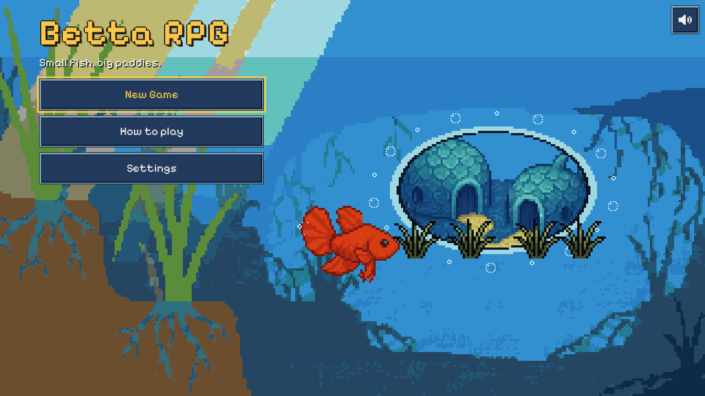
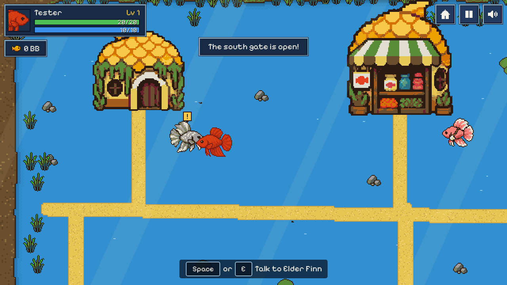
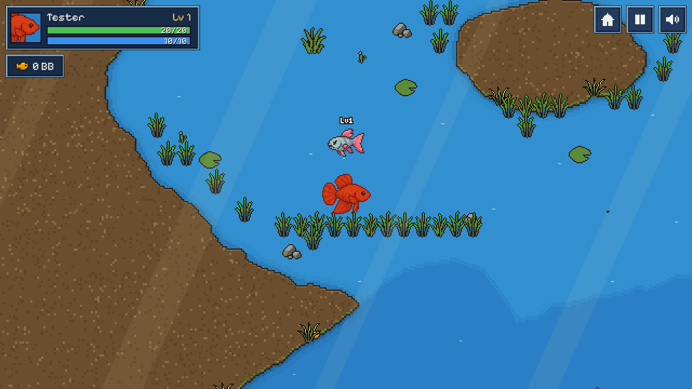
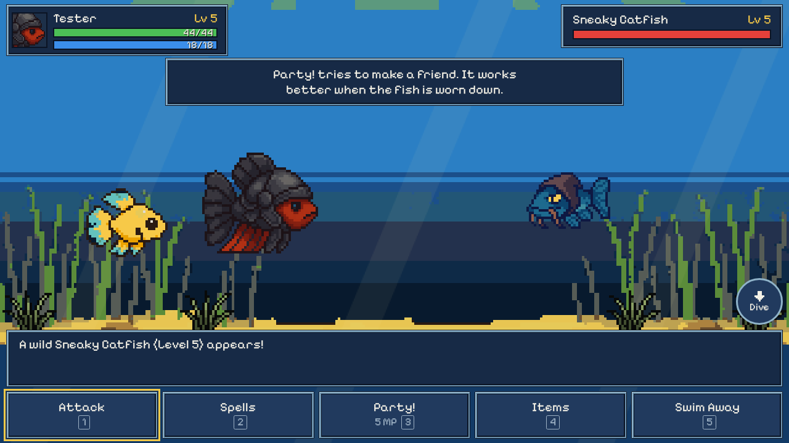
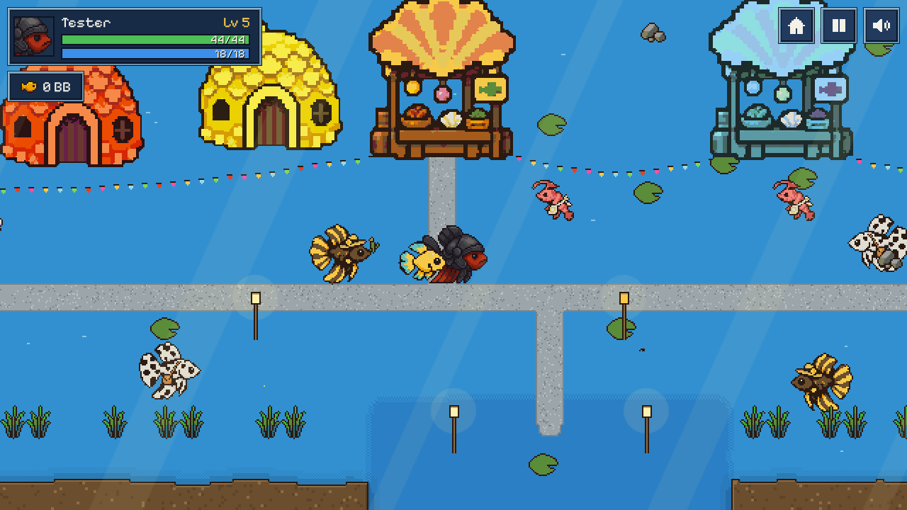
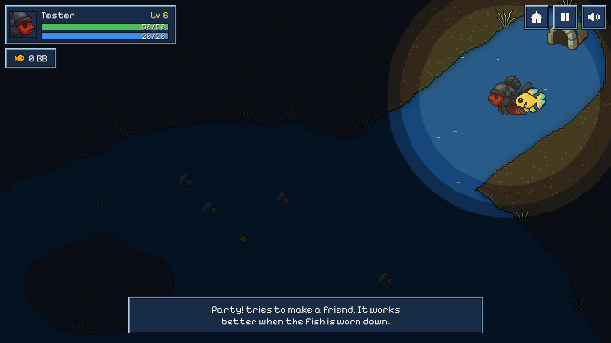
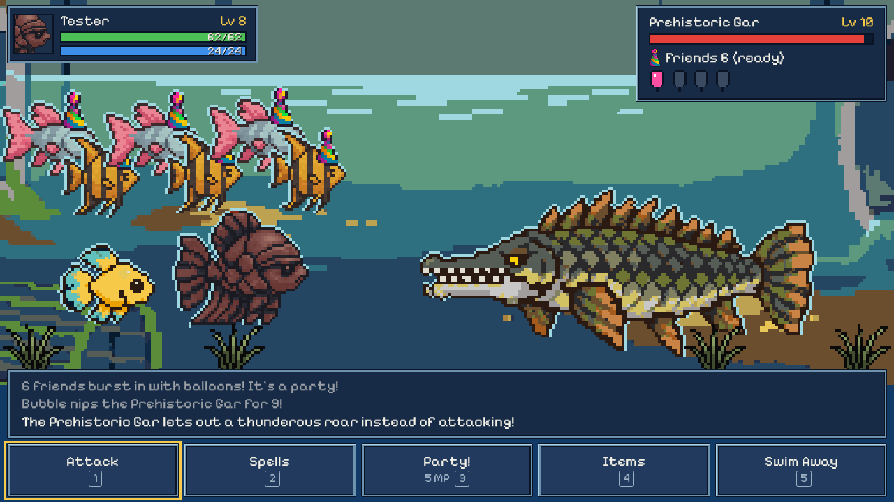
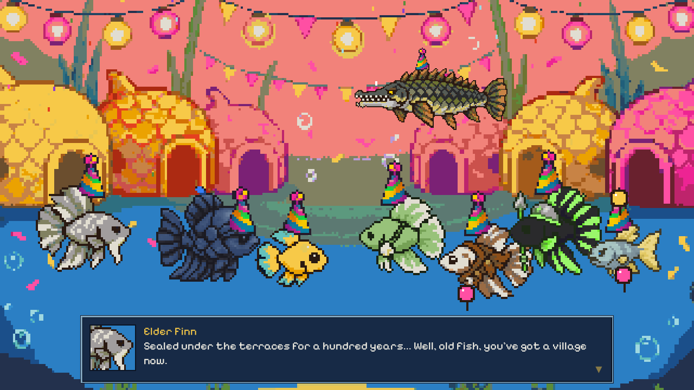

# Betta Fish RPG

*Small fish, big paddies. Find the missing fish, with your fins or your friendship.*

You're a young betta from Paddy Village, and fish keep vanishing from the outer paddies.
Swim the sunlit rice-paddy terraces, battle or befriend the fish in your way, gear up from
helmet to full metal, and follow a trail of strange scales up to the city on the next
terrace and down into the dark Murk, where something very old and very lonely is waiting.
Every fight can become a friendship, and the village remembers what you did.

**[▶ Play Betta Fish RPG](https://bettafishrpg.synapticnoise.com/)** in your browser. No
install, works on desktop and on phones, with keyboard, mouse, touch or a controller.

## The paddies

| | |
|---|---|
|  |  |
| **Paddy Village.** Elder Finn, Shopkeeper Coral, Guard Captain Reef, Bubble the Brave and the Swishy Solace Inn. | **The Shallows.** Your first fights, your first friend, and the Old Stump, where Bubble finally comes along. |
|  |  |
| **Battles.** Attack, Bubble Blast, Gravel Grenade, or **Party!**: Happy Balloon Time makes a friend instead of a fight. | **Highwater**, the city on the next terrace, where the Lock-Keeper knows what happened to the drain gate. |
|  |  |
| **The Murk.** Dark water, a borrowed lantern, three lost cogs, and Level-10 fish at the edges. | **The Gargantuan Gar.** Beat it, or bring five friends and throw it a party. |

## How to play

- **Swim:** arrow keys or WASD. On a phone, drag on the left side of the screen. On a
  controller, the left stick or d-pad.
- **Talk, pick up, confirm:** Space, E or Enter (✕ / A on a controller, the Talk button on a
  phone).
- **Battle:** Attack, Spells, **Party!**, Items or Swim Away (keys 1 to 5). Party! works
  best once a fish is worn down, and a new friend gives the same rewards as a win.
- **Items:** I. **Go home to the village:** H or Home. **Pause:** Esc or P. **Mute:** M.
- Keys and controller buttons can be changed in Settings → Controls.
- Plug in a PS5 controller (USB or Bluetooth) and press any button; it works best in Chrome
  or Edge. Xbox and Switch Pro controllers work too.
- On a phone, hold it sideways. You can install the game from your browser's menu to play
  full screen, even offline.
- Found a bug? Pause and pick "Report a bug", or press Ctrl+Shift+F (you'll need a GitHub
  account).

Losing a battle is never the end: you wake at your last rest point with a few Betta Bites
fewer. Progress saves by itself, and Continue picks up where you left off. There are two
endings, and a reward for making friends with every kind of fish in the paddies.

## How it was made

Betta Fish RPG is a remake of [the original Betta Fish RPG](https://github.com/zeveck/bettarpg)
(2025), made by [Claude Code](https://claude.com/claude-code) with
[gamegen](https://github.com/zeveck/gamegen), from this request:

> `/gamegen --remake https://github.com/zeveck/bettarpg --leeway lots --plan-only --share-design --mockups $10`

gamegen surveyed and played the original, proposed a plan for the remake (kept exactly: all
of the original's art, names and quirks; new: a world to swim through, Bubble as a
companion, the city on the next terrace, and an answer to the mystery), and, once approved
("Proceed with the plan."), wrote the design, had it reviewed in two rounds by a player, a
builder and an art-and-sound director, and shared it with mock pictures. Then:

> `/gamegen --plans`

put the plan on [the plans page](https://synapticnoise.com/plans/), and

> `/gamegen --continue --budget 50 --gamepad --controls --feedback --art-sheet --publish`

built it, with controller support, changeable controls and a "Report a bug" button. gamegen
made the art and sound with these plugins, built the game, and play-tested it (two rounds of
final review, a polish pass on every screen at every size, and recorded routes that play the
whole game from New Game to the credits):

- [imagegen2](https://github.com/zeveck/imagegen2): the villagers, Highwater's folk, the
  village and Highwater buildings, the Dragonfly Nymph and Snapping Crayfish, the Gargantuan
  Gar, props, rice and item icons, all drawn to match the original sprites' pixel grid.
- [nanogen](https://github.com/zeveck/nanogen): the title, battle and ending backdrops.
- [anim8gen](https://github.com/zeveck/anim8gen): the betta's swim and the Gar's lunge.
- [audiogen](https://github.com/zeveck/audiogen): eight songs and twenty-eight sound effects.

The original game's pixel art (the betta in four armor stages, the five enemies, the party
hats, the submarine, Paddy Village and the rice tuft) is used as it was, shrunk to its
native pixels; the full-size originals are in `source-art/`. The design, reviews and asset
notes are in [`design/`](design/).

## Replaying the tests

Every area and both endings have a recorded route in `design/solutions/`, the proof the game
can be finished. Serve the `game` folder, open it in a `playwright-cli` session, then replay
routes with real key presses:

    tools/run-routes.sh <session> design/solutions/area-1-shallows.json
    tools/run-routes.sh <session> design/solutions/*.json

`tools/check-routes.mjs` checks every route's waypoints are in open water.
`node tools/sim-battles.mjs` plays every tuning fight 4,000 times and checks the balance
targets (both paths, fins and friendship), against the design's own
`tools/sim_design.py`.

## Playing locally

Betta Fish RPG is a plain web page with no build step. Serve the `game` folder with any
static web server, for example:

    cd game
    python3 -m http.server 8000

then open http://localhost:8000.

## Credits

Idea and original game by Rich Conlan. Font: BettaPixel, made from Pixelify Sans (SIL Open
Font License, `game/fonts/OFL.txt`).
